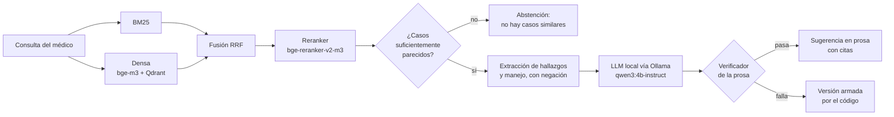

# RAG clínico local sobre un registro de trauma

Chatbot que, ante la descripción de un paciente de trauma, **recupera casos
análogos de un registro hospitalario y resume qué se hizo en ellos**, con una
cita verificable en cada afirmación. Todo corre en local, sin APIs externas:
ningún texto clínico sale de la máquina, y funciona en una GPU de 4–8 GB.

Es la segunda mitad de un proyecto de dos partes. El corpus que indexa lo
produce el pipeline de anonimización:
**[trauma-anonimizacion](https://github.com/hoseStr/anonimizacion-trauma)**.

> **Sin datos.** Este repositorio contiene solo código y documentación. Los
> índices, el corpus y los reportes de evaluación con texto clínico no se
> publican. Las cifras de este README son agregados de la evaluación real
> sobre 8.198 casos.

## Cómo funciona



1. **Recuperación híbrida.** BM25 capta los términos literales y las
   abreviaturas (`HPAF`, `TCE`); la ruta densa con bge-m3 cierra la brecha de
   registro entre la consulta clínica ("herida penetrante en tórax") y la voz
   del paciente que domina el corpus ("ME APUÑALARON"). Se fusionan con
   Reciprocal Rank Fusion y un cross-encoder reordena los 30 primeros.
2. **Abstención en dos guardas.** Coseno mínimo del mejor caso y probabilidad
   mínima del reranker por caso. Si no hay al menos 2 casos que pasen, el
   sistema dice que no encontró casos similares en lugar de responder.
3. **Los conteos los hace el código, no el modelo.** `rag/hallazgos.py` extrae
   hallazgos, estudios y manejo de cada caso con reglas que entienden negación
   ("sin sangrado activo"), interconsulta frente a cirugía hecha y erratas del
   corpus. La tabla y los conteos ("tubo de tórax en 4 de 5 casos") salen de ahí.
4. **El modelo elige y redacta, con salida restringida.** Ollama recibe un
   JSON Schema con `enum`: el modelo solo puede sugerir elementos que existen
   en los casos recuperados.
5. **Cada oración se verifica antes de mostrarse.** `rag/verificar.py`
   comprueba que lo que nombra esté en los casos, que el caso citado lo
   contenga, que los números cuadren y que la frase oriente en vez de ordenar.
   Si algo falla, se muestra la versión determinista y una línea dice por qué.

## Resultados

Evaluación con 35 consultas escritas en registro clínico (`eval/consultas.yaml`):
25 de trauma en cinco categorías, según el fenómeno que ponen a prueba, y 10
fuera de dominio (cetoacidosis, infarto, apendicitis…).

| Ruta | nDCG@10 | P@5 | R@10 | MRR | Fuera de dominio bloqueadas |
|---|---|---|---|---|---|
| BM25 | 0,708 | 0,496 | 0,279 | 0,631 | 2 / 10 |
| Densa (bge-m3) | 0,725 | 0,456 | 0,283 | 0,735 | 2 / 10 |
| RRF (BM25 + densa) | 0,746 | 0,504 | 0,335 | 0,631 | 2 / 10 |
| **RRF + reranker** | **0,787** | **0,544** | **0,338** | **0,735** | **9 / 10** |

nDCG@10 por tipo de consulta:

| Categoría | BM25 | Densa | RRF | RRF + reranker |
|---|---|---|---|---|
| Léxica (el término aparece literal) | 0,830 | 0,842 | 0,844 | 0,869 |
| Vocabulario (sinónimos, registro distinto) | 0,678 | 0,733 | 0,717 | 0,776 |
| Abreviatura | 0,653 | 0,681 | 0,742 | 0,780 |
| Ortográfica (erratas) | 0,783 | 0,782 | 0,773 | 0,839 |
| Fina (mecanismo + región + detalle) | 0,560 | 0,534 | 0,623 | 0,637 |

Ninguna de las 25 consultas de trauma se abstiene en ninguna ruta. El umbral
del reranker se calibró con `scripts/calibrar_umbral.py`.

**Sobre estas métricas:** la relevancia está pre-anotada por metadatos
(mismo mecanismo de lesión y misma región anatómica). Es un proxy útil para
elegir ruta, no una medida de utilidad clínica. El ideal del nDCG se calcula
sobre la unión de lo que traen todas las rutas (pooling), para que sean
comparables. `eval/evaluate.py` exporta una muestra para validación manual y
`scripts/exportar_revision.py` genera una planilla ciega para que un médico
califique las respuestas (rúbrica adaptada de Med-PaLM).

**Latencia:** ~16–20 s por respuesta en una GTX 1650 de 4 GB con
`qwen3:4b-instruct` (sin reranker, que no cabe junto al generador). Detalle
por tarjeta en [`MODELOS.md`](MODELOS.md).

## Decisiones de diseño

- **Todo local.** bge-m3 para embeddings, Qdrant en modo embebido (sin Docker),
  Ollama para el generador. El presupuesto de VRAM manda: bge-m3 usa la GPU
  solo al indexar y en consulta corre en CPU en bf16 (~150 ms por consulta),
  dejando la GPU para el generador y el reranker. `RUTA=auto` decide según la
  VRAM disponible.
- **El modelo escribe poco.** Síntesis, tabla de casos y límites los arma el
  código; el modelo de 3B que se probó primero inventaba en esas secciones.
  Menos tokens generados también es menos latencia.
- **bge-m3 cargado con `transformers` directo** (pooling CLS + L2), sin
  depender de sentence-transformers para la ruta densa.
- **`ENCODER=falso`** sustituye los embeddings por un hash de bolsa de
  palabras para probar la tubería completa sin descargar modelos.

## Estructura

```
app.py                  chatbot en Streamlit: filtros por mecanismo, región y desenlace,
                        casos consultados con lo que coincide resaltado
rag/
  config.py             toda la configuración, sobrescribible por variables de entorno
  corpus.py             carga del JSONL que produce trauma-anonimizacion
  encoder.py            bge-m3 (transformers), sentence-transformers o encoder falso
  index.py              construye BM25 y el índice denso en Qdrant
  retrieve.py           rutas bm25 · densa · rrf · rerank, filtros y abstención
  hallazgos.py          extracción de hallazgos, estudios y manejo con negación
  build_prompt.py       prompt y armado determinista de la respuesta
  generate.py           llamada a Ollama, salida estructurada, ensamblado
  verificar.py          verificación de cada oración de la prosa
eval/
  consultas.yaml        35 consultas de evaluación y demo
  evaluate.py           nDCG@10, P@5, R@10, MRR por ruta y categoría
scripts/                revisión del entorno, calibración de umbrales, comparación
                        de modelos, planilla de revisión médica, preparación de demo
tests/                  hallazgos, ensamblado, verificador, reranker, evaluación
```

## Cómo ejecutarlo

Necesitas el corpus generado por
[trauma-anonimizacion](https://github.com/hoseStr/anonimizacion-trauma)
(`corpus_indexable.jsonl`) y [Ollama](https://ollama.com).

```bash
pip install -r requirements.txt          # instalar torch antes, ver SETUP.md
ollama pull qwen3:4b-instruct

cp /ruta/a/corpus_indexable.jsonl data/  # o definir CORPUS_JSONL
python scripts/revisar_entorno.py        # comprueba GPU, modelos, corpus e índices
python -m rag.index                      # BM25 + índice denso
python -m eval.evaluate --rutas bm25,densa,rrf,rerank
streamlit run app.py
```

Los tests no necesitan índices, modelos ni Ollama:

```bash
python -m pytest tests/ -q
```

Guía completa (torch con CUDA, presupuesto de VRAM, variables de entorno,
problemas comunes y guion de demo): [`SETUP.md`](SETUP.md). Elección del
generador según la tarjeta: [`MODELOS.md`](MODELOS.md).

## Privacidad de los datos

El corpus proviene de historias clínicas de un registro hospitalario
colombiano (Ley 1581 de 2012). Aunque está anonimizado, no se publica, y
tampoco los índices, que contienen el texto completo de los casos, ni los
reportes de evaluación con fragmentos recuperados. `.gitignore` excluye
`data/`, `indices/`, `reports/`, `eval/revision/` y cualquier archivo de datos.
Las consultas de `eval/consultas.yaml` y los textos de los tests están
redactados a mano.

El sistema es un prototipo de apoyo: sugiere a partir de lo que se hizo en
casos históricos, no indica conductas ni reemplaza el juicio clínico.

## Stack

Python · bge-m3 · bge-reranker-v2-m3 · Qdrant (local) · rank-bm25 ·
Ollama (Qwen3-4B-Instruct) · Hugging Face transformers · PyTorch · Streamlit ·
pandas · pytest
